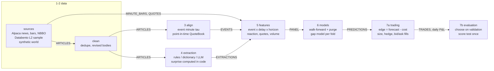

# 230P: Trading News Mispricing, Net of Costs

**Objective.** Find and monetize temporary mispricing after news, maximizing
out-of-sample risk-adjusted profit after realistic execution costs and capital
limits. Only results on news published **after the LLM's training cutoff**
count. Model complexity is justified only by its added net profit.

Research plan: see the team's 230P Research Plan doc. This repo implements it.

## Architecture in one picture

Data flows strictly left to right. Each arrow is a typed table defined in
[`src/newsalpha/schemas.py`](src/newsalpha/schemas.py); each box is one package.



The whole run is [`src/newsalpha/pipeline.py`](src/newsalpha/pipeline.py),
about 60 lines, one call per stage. Read it first.

## Stages

| # | Stage | Package | Input → output | Key rule |
|---|---|---|---|---|
| 1 | Load | `data/sources` | vendor APIs → ARTICLES, MINUTE_BARS, QUOTES | Quotes are minute snapshots stamped at minute **end** |
| 2 | Clean | `data/clean.py` | ARTICLES → ARTICLES | Bodies revised > 60 min after creation are unusable |
| 3 | Align | `align.py`, `calendar.py` | ARTICLES → EVENTS | tau = first full minute after `created_at`; outside the session → next open |
| 4 | Extract | `extraction/` | ARTICLES → EXTRACTIONS | The LLM reads numbers; code computes surprises; cached by text hash |
| 5 | Features | `features/panel.py` | EVENTS × delays × horizons → PANEL | Features use data ≤ entry time only |
| 6 | Predict | `models/walkforward.py` | PANEL → PREDICTIONS | Monthly walk-forward; train labels never overlap test; gap fitted per fold |
| 7 | Trade + evaluate | `trading/`, `evaluation/` | PREDICTIONS → TRADES → report | Edge = forecast − cost; trade only if edge > κ·σ̂; profit metrics first |

## Repository layout

```
configs/                 one YAML = one fully specified run (hash keys every artefact)
  synthetic.yaml         runs with no API keys; CI integration test
  alpaca_llm.yaml        real-data template (Alpaca + vLLM on the GPU server)
src/newsalpha/
  config.py              typed config (pydantic)
  schemas.py             the data contracts between stages
  calendar.py            NYSE sessions, event minute, horizon exits
  align.py               ARTICLES -> EVENTS, point-in-time QuoteBook
  data/
    sources/             alpaca.py, databento_src.py, synthetic.py
    storage.py           raw / interim / features / processed / runs (mirrors Drive)
    clean.py
  extraction/
    schema.py            RawExtraction (what the LLM fills) + finalize (surprises in code)
    rules.py             regex baseline, also the "simple rule" benchmark
    dictionary.py        Loughran-McDonald tone
    llm.py               any OpenAI-compatible endpoint (vLLM or API teacher)
    prompts/event_v1.md
  features/
    panel.py             event x delay x horizon rows, features and labels
    gap.py               per-delay reaction gap, fitted on train folds only
  models/
    base.py              Ridge and LightGBM
    walkforward.py       out-of-sample predictions
  trading/
    costs.py             spread, impact, borrow, hedge
    rules.py             edge and the trade / no-trade decision
    sizing.py            edge / sigma^2 with capital and liquidity caps
    backtest.py          bid/ask fills, ETF hedge, P&L by exit day
  evaluation/
    splits.py            walk-forward with purging
    metrics.py           Sharpe, deflated Sharpe, drawdown, per-trade stats, rank IC
    report.py            select on validation, report test: headline, decay, capacity
  live/paper.py          paper-trading loop skeleton and latency log
  pipeline.py            the seven stages in order
  cli.py                 `newsalpha run --config ...`
tests/                   leakage, calendar, extraction, trading, metrics, end-to-end
docs/ARCHITECTURE.md     contracts, timing rules, extension points
.github/workflows/       ci.yml (every PR), extract.yml + train_eval.yml (GPU, manual)
```

## Quickstart

```bash
uv venv && source .venv/bin/activate
uv pip install -e ".[dev]"
pytest                                        # includes the no-look-ahead tests
newsalpha run --config configs/synthetic.yaml # full pipeline, no keys needed
cat data/runs/synthetic_demo_*/report.md
```

The synthetic world plants a known underreaction, so its numbers are large by
construction. They show the pipeline works, not that the strategy does.

## Real data

1. Put keys in `.env` on the GPU server (never in the repo):
   `ALPACA_API_KEY_ID`, `ALPACA_API_SECRET_KEY`, `DATABENTO_API_KEY`, `NEWSALPHA_LLM_API_KEY`.
2. Serve a model: `vllm serve <model> --port 8000`.
3. Edit `configs/alpaca_llm.yaml`: set `model_cutoff` to the model's knowledge
   cutoff and keep `test_start` after it.
4. `newsalpha run --config configs/alpaca_llm.yaml`.

Run a few days first: the Alpaca adapter follows the public API docs but has
not yet been run against a live key.

## Security

Keep this repository **private** while the GPU server is registered as a
self-hosted runner: on a public repo, a fork's pull request can run code on it.
GPU workflows are manual (`workflow_dispatch`) and only run once a runner with
labels `self-hosted, gpu` is registered.
